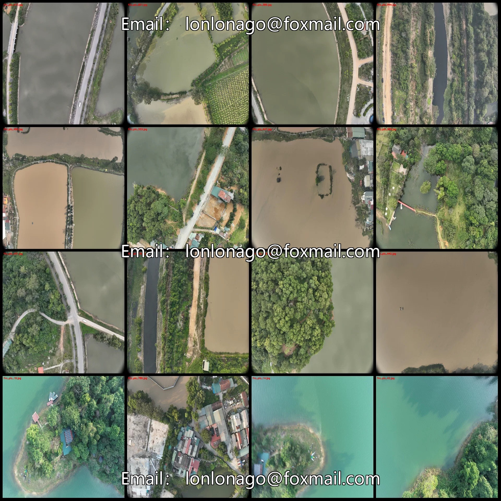
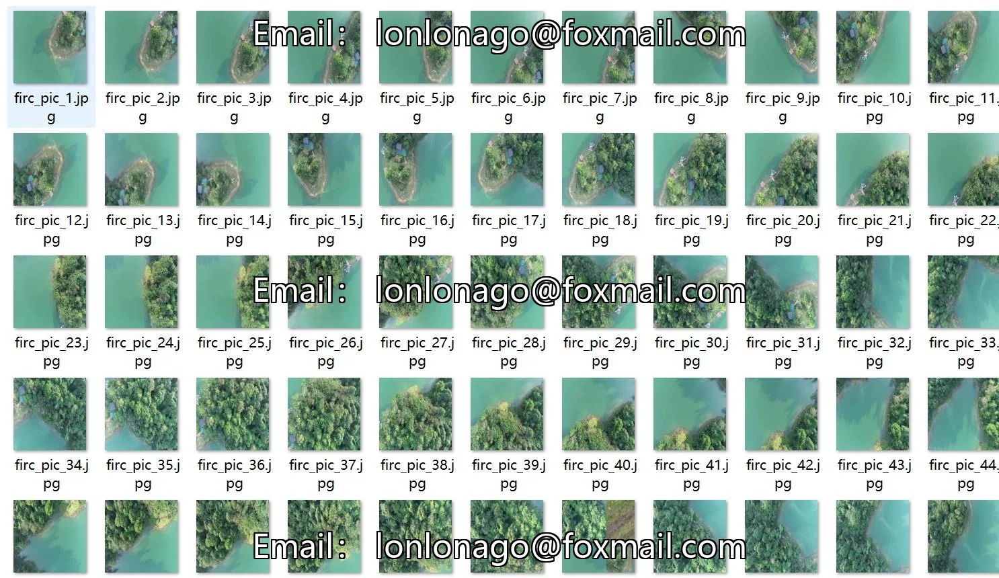
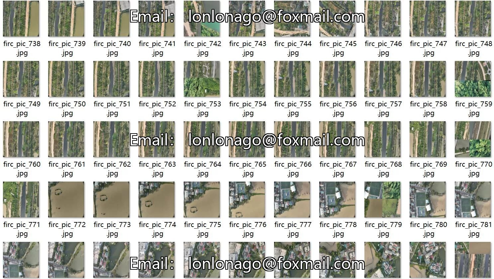
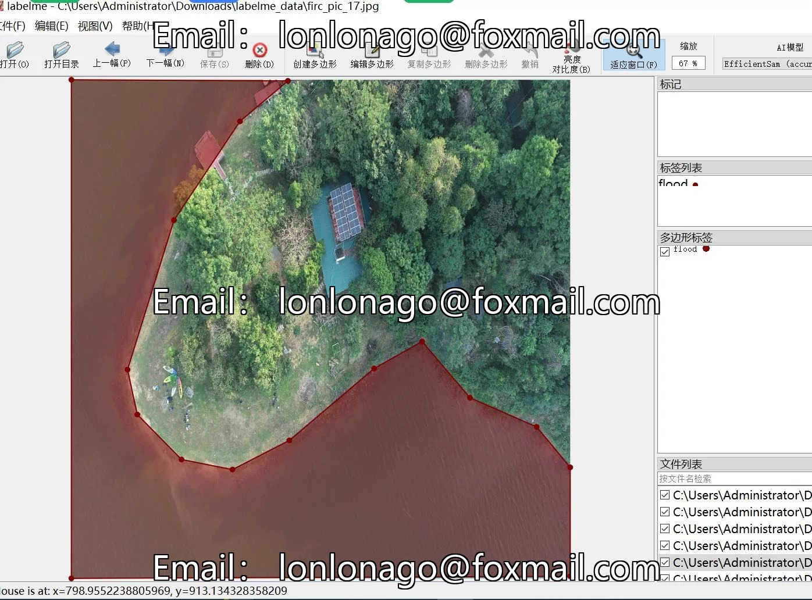
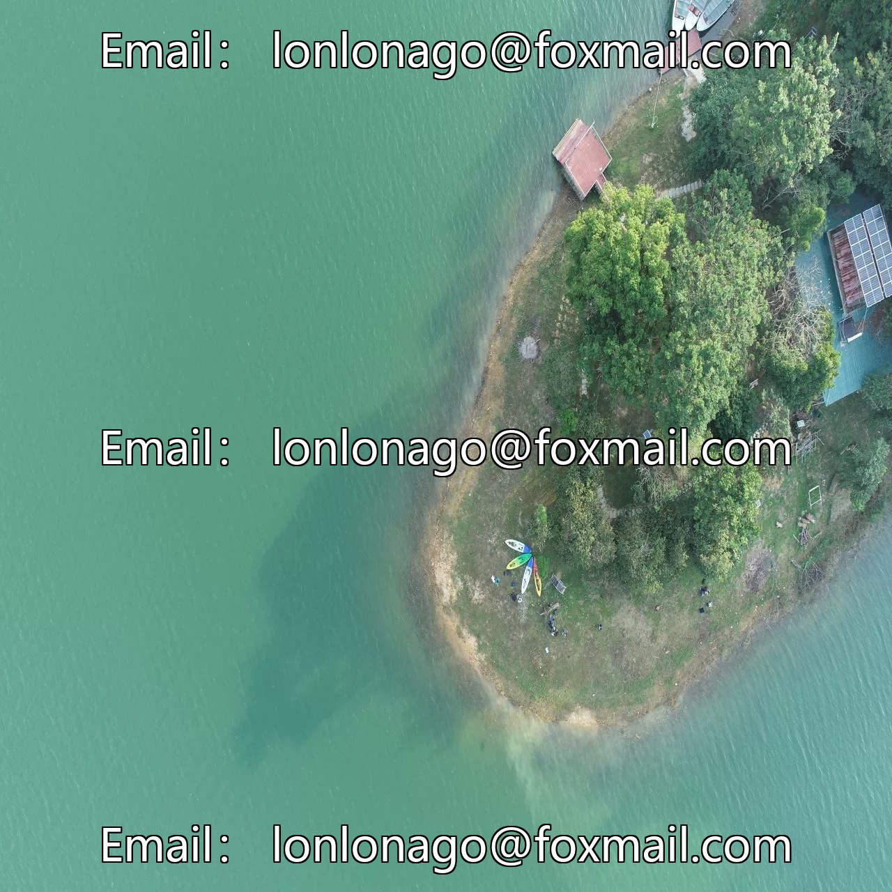
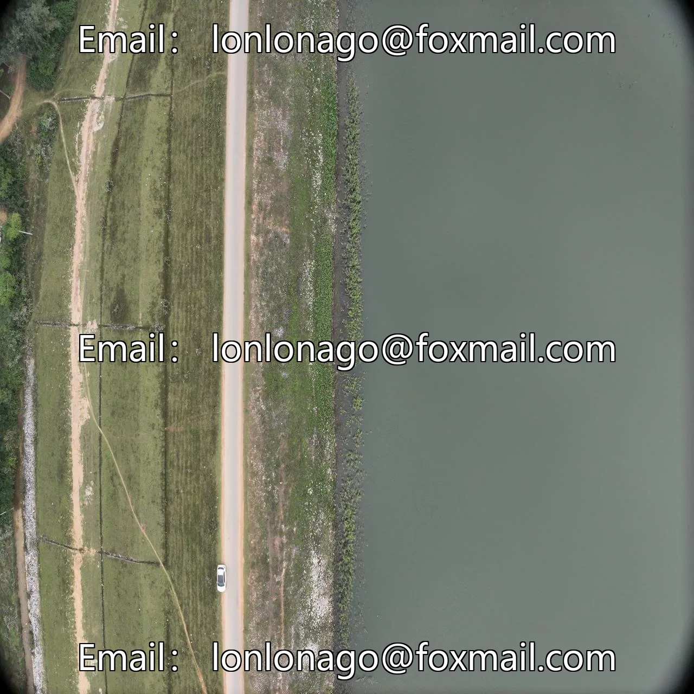
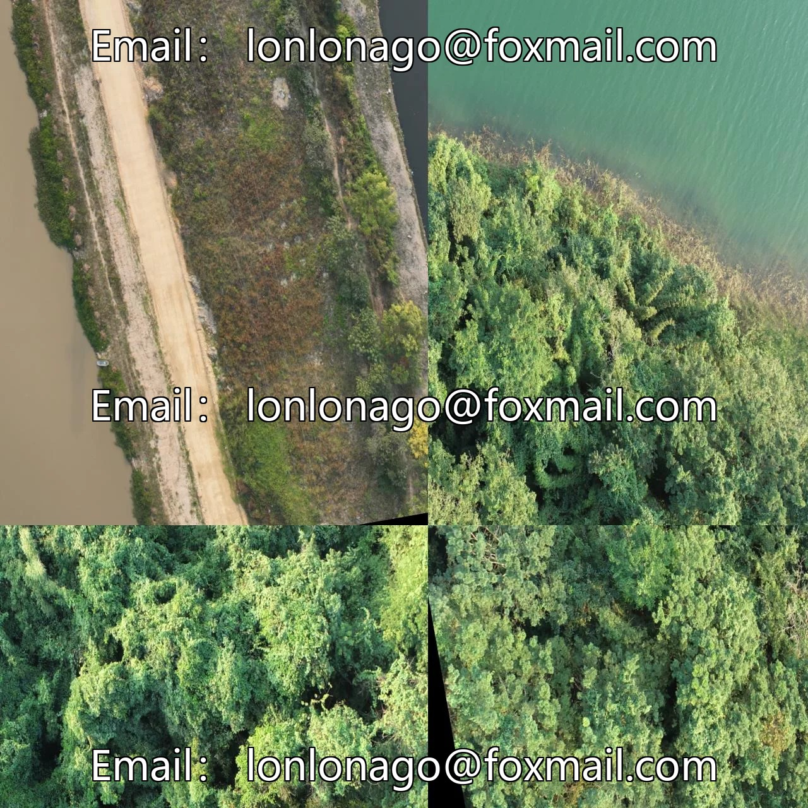

# Drone-view aerial photography flood river surface disaster identification flood identification segmentation dataset labelm

## Body

Drone-view aerial photography flood disaster identification flood segmentation dataset labelme format 857 categories
Warm Reminder: Due to the dataset's replicability, please confirm compliance with requirements before purchasing.
Dataset format: labelme format (excluding mask files, only containing jpg images and corresponding json files)
Number of images (number of jpg files): 857
Number of annotations (number of json files): 857
Number of annotation categories: 1
Annotation category names: ["flood"]
Each category annotation box count and image count per category
Flood boxes = 1941, image count = 857
Total boxes: 1941
Annotation tool used: labelme=5.5.0

Image resolution: 1280x1280
Annotation rules: Polygons are drawn around the categories.
Important Note: The dataset can be opened and edited using labelme, and the JSON dataset needs to be converted into either mask or yolo format for semantic segmentation or instance segmentation.
Special : This dataset does not guarantee any accuracy in the trained models or weight files.

## Images

## Payment

Here is a pay link on Stripe ( https://buy.stripe.com/3cs8yP7sY87d0vu9AB ). Please contact me lonlonago@foxmail.com after funding $89, and I will send you a complete data files , thank you!

